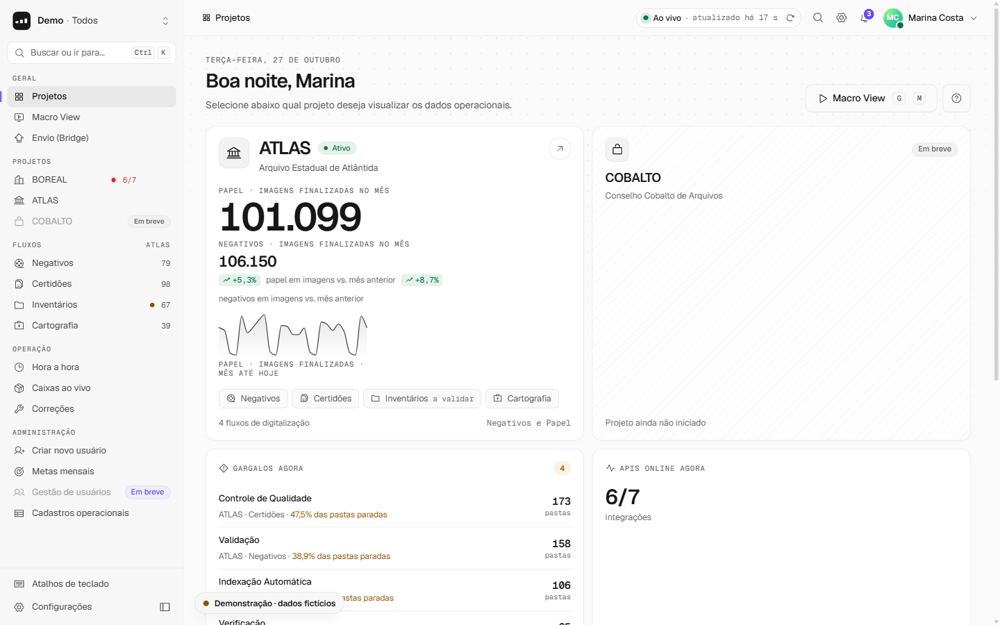
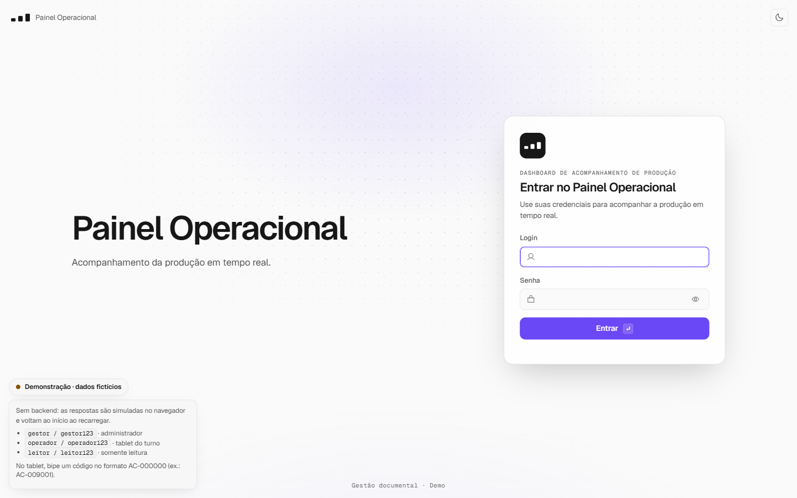
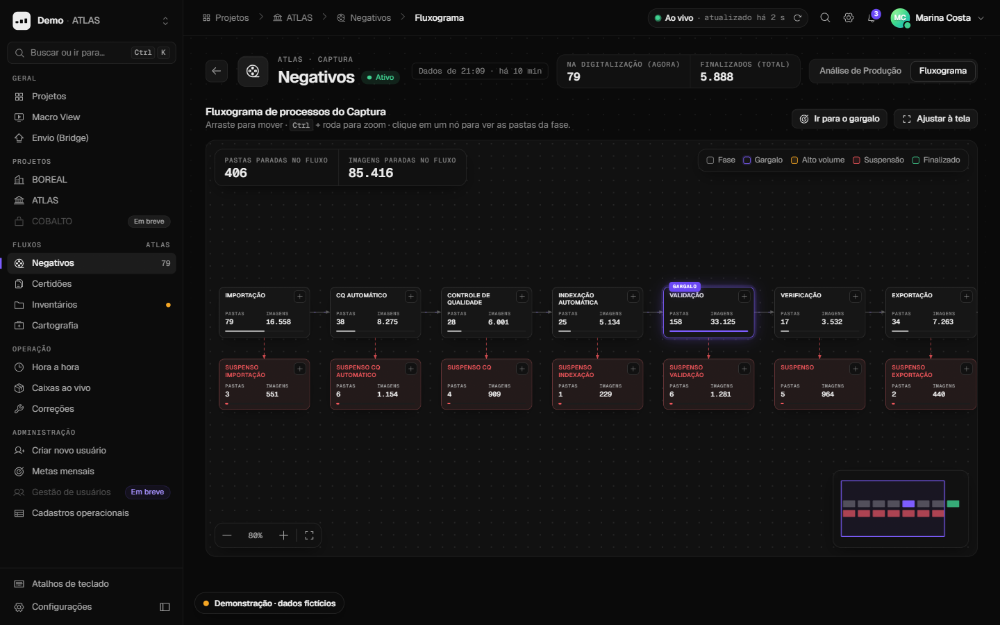
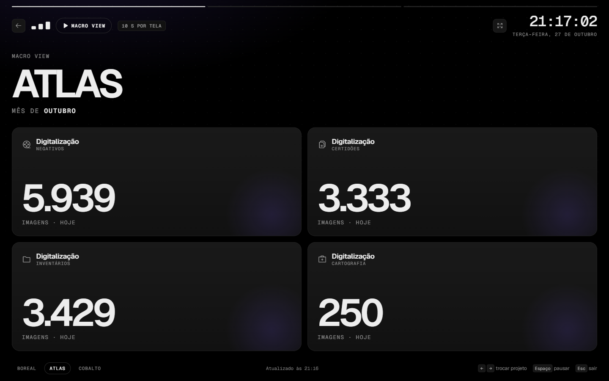
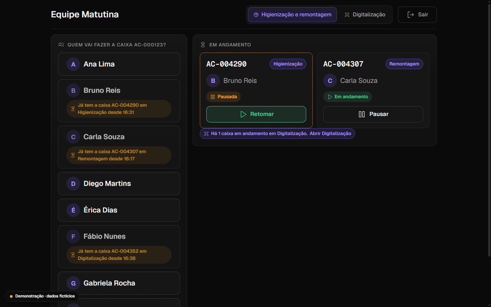
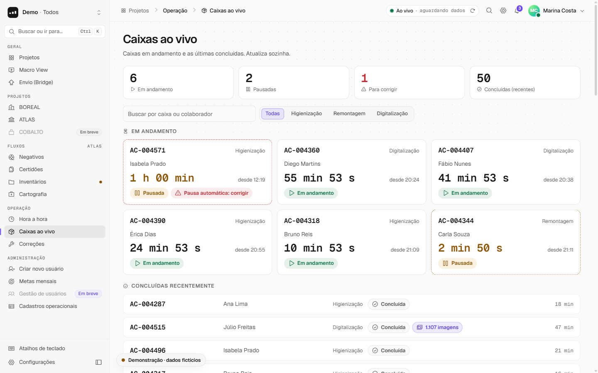
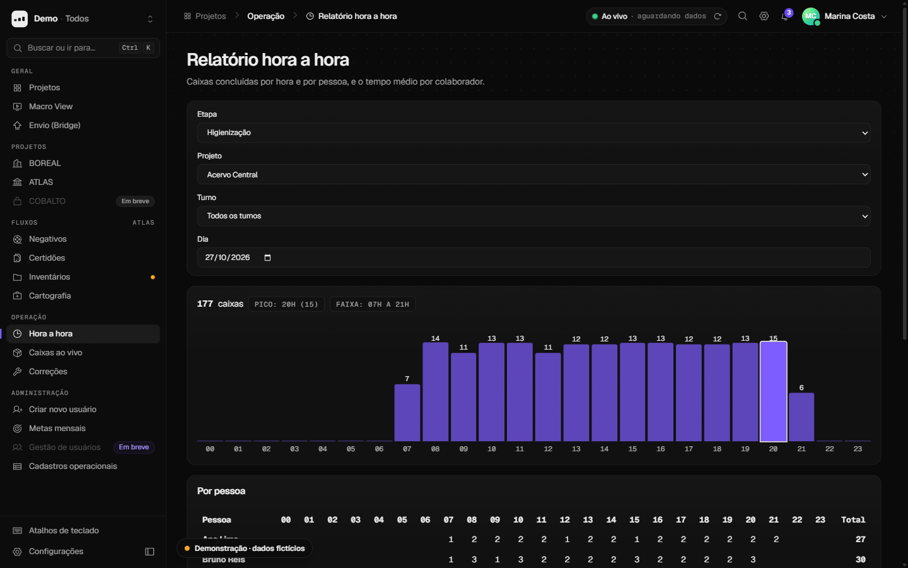
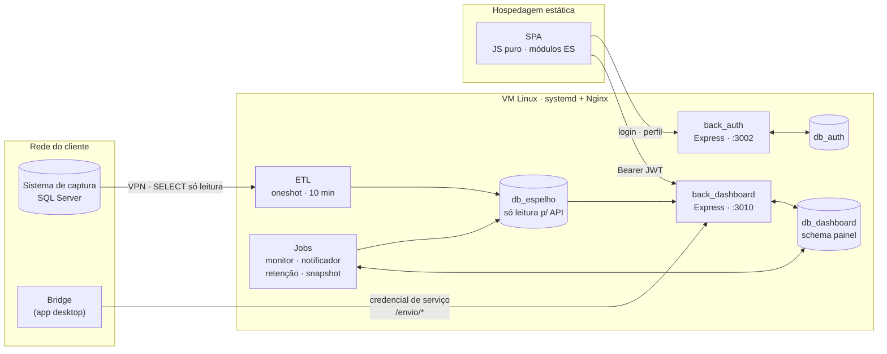
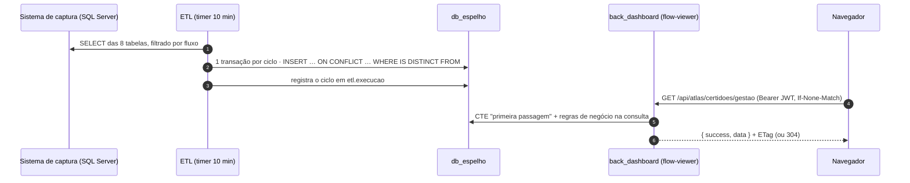
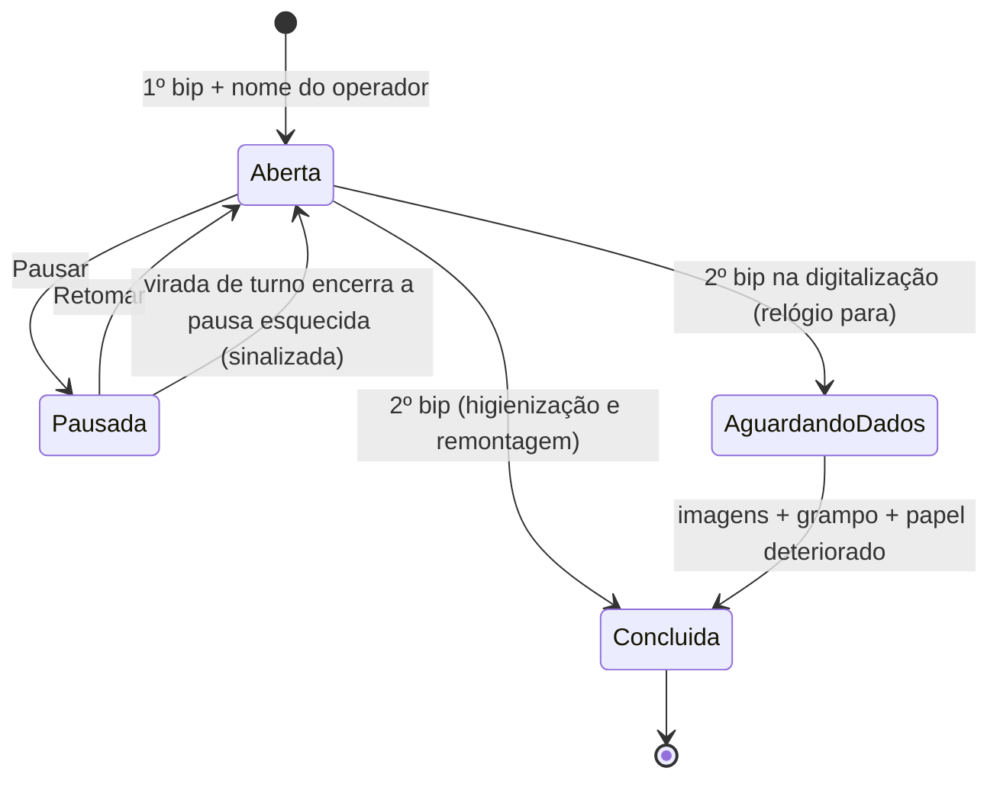

# Painel Operacional

**Dashboards de produção para projetos de gestão documental e digitalização:** acompanhamento por fase, fluxogramas interativos, detecção de gargalos, metas, notificações, relatórios, modo TV e um módulo operacional para o chão de fábrica, com rastreio de cada caixa por pessoa e por tempo.

> **Sobre este repositório.** Este é um **modelo de apresentação (showcase)** de um sistema desenvolvido para uso interno na empresa **HW1**. Depois de aprovado, o sistema passou a ser usado em produção. Aqui está o código completo da aplicação (frontend, backends, ETL, jobs, testes e CI), mas **sem nenhum dado real**: clientes, projetos, pessoas, sistemas de terceiros e domínios foram trocados por nomes fictícios, e o modo demonstração roda com dados inventados gerados no próprio navegador.

<p align="center">
  
</p>

---

## Sumário

- [O problema](#o-problema)
- [O que o sistema faz](#o-que-o-sistema-faz)
- [Experimente em 1 minuto](#experimente-em-1-minuto)
- [Capturas de tela](#capturas-de-tela)
- [Arquitetura](#arquitetura)
- [Stack](#stack)
- [Fluxo de dados e banco de dados](#fluxo-de-dados-e-banco-de-dados)
- [Integrações com sistemas externos](#integrações-com-sistemas-externos)
- [Módulo operacional](#módulo-operacional)
- [Segurança](#segurança)
- [Qualidade e testes](#qualidade-e-testes)
- [CI/CD e deploy](#cicd-e-deploy)
- [Estrutura do repositório](#estrutura-do-repositório)
- [Rodando com o backend de verdade](#rodando-com-o-backend-de-verdade)
- [Decisões de engenharia](#decisões-de-engenharia)
- [Documentação](#documentação)
- [Autoria e licença](#autoria-e-licença)

---

## O problema

Projetos de digitalização de acervo passam por uma esteira longa: as caixas de documentos chegam, são higienizadas, digitalizadas, conferidas, indexadas, exportadas e enviadas ao repositório final. A produção fica registrada no **sistema de captura** de cada cliente, um SQL Server dentro da rede dele, lento para consultas analíticas e fora do nosso controle. As etapas manuais, como a higienização, não eram medidas.

Coordenadores e gerentes precisavam saber, sem abrir o sistema de captura:

- quanto foi produzido no mês e se a meta vai ser batida;
- **onde está o gargalo agora**;
- quanto tempo cada caixa leva em cada etapa manual, e com quem;
- se os pacotes finais estão de fato chegando ao repositório de destino.

## O que o sistema faz

**Vertente de gestão** (coordenadores, supervisores e gerentes)

- **Seleção de projetos**: cartões com imagens e pastas finalizadas no mês, sparkline, variação contra o mesmo período do mês anterior, meta, projeção no ritmo atual e gargalos.
- **Fluxograma interativo** de cada fluxo de trabalho: fases, junções e suspensões desenhadas a partir de configuração, com zoom, minimapa, contagem ao vivo por fase, gargalo realçado e um modal por fase com as pastas paradas (por pasta ou por lote).
- **Análise de produção**: KPIs por fase, imagens por dia, tipologia (projeto × lote) e relatório por período exportável em XLSX/CSV.
- **Metas mensais**, **central de notificações** (gargalo, ETL atrasado, meta atingida, API fora do ar) e **atividade recente** a partir da trilha de auditoria.
- **Macro View**: modo TV em tela cheia que roda pelos projetos, resiliente a falhas por bloco.
- **Envio (Bridge)**: acompanhamento do envio das pastas ao repositório final, com sinal de vida, funil, vazão e eventos.
- **Monitoramento de APIs** com histórico, teste manual e alertas.

**Vertente operacional** (operadores no chão de fábrica)

- **Tablet do turno**: o operador bipa o código da caixa, escolhe o próprio nome e o sistema mede o tempo líquido, com pausas, por pessoa e por etapa. A tela é simples, com botões grandes, cores, retorno visual imediato e nenhum dado individual exposto a terceiros.
- **Digitalização**: registra imagens, grampo e papel deteriorado por caixa.
- **Gestão do operacional**: caixas ao vivo, correções auditadas (com confirmação de senha), relatório hora a hora, tempo médio por etapa e cadastros (projetos, turnos, colaboradores, mesas e metas).

Transversais: paleta de comandos (`Ctrl+K`), atalhos de teclado, tema claro e escuro, layout responsivo e acessibilidade AA verificada por teste automatizado.

## Experimente em 1 minuto

Requisito: **Node.js 20.6+**. O modo demonstração não instala nada nem precisa de banco ou backend.

```bash
git clone <url-deste-repositório> painel-operacional
cd painel-operacional
npm run demo
```

Abra **http://localhost:4173/app/demo.html** e entre com um dos usuários fictícios:

| Usuário | Senha | Perfil | O que mostra |
|---|---|---|---|
| `gestor` | `gestor123` | admin | Todas as telas de gestão, metas, cadastros e correções |
| `operador` | `operador123` | turno | Tablet do turno e digitalização (bipe, por exemplo, `AC-000123`) |
| `leitor` | `leitor123` | standard | Gestão em modo consulta |

A demonstração usa exatamente o mesmo frontend da produção. A única diferença é uma API simulada que intercepta as chamadas no navegador e responde com dados fictícios que mudam conforme você usa: bipar, pausar e concluir caixas, definir metas, marcar notificações como lidas. Como não depende de servidor, também funciona em qualquer hospedagem estática, como o GitHub Pages. Detalhes em [docs/modo-demonstracao.md](docs/modo-demonstracao.md).

## Capturas de tela

| | |
|---|---|
|  |  |
| **Login** com animação que reflete as etapas reais | **Fluxograma** com contagem por fase e gargalo realçado |
|  |  |
| **Macro View** para TVs | **Tablet do turno**: bipagem de caixas |
|  |  |
| **Caixas ao vivo** | **Relatório hora a hora** e tempo médio |

## Arquitetura



| Componente | Pasta | Papel |
|---|---|---|
| Frontend | `public/app/` | SPA de gestão, Macro View e telas operacionais |
| `back_auth` | `services/back_auth/` | Identidade: login, perfil, preferências, senha, criação de usuário, credencial de serviço |
| `back_dashboard` | `services/back_dashboard/` | API única do painel para todos os projetos |
| ETL | `services/etl/captura/` | Copia as tabelas de produção do sistema de captura para o espelho Postgres |
| Jobs | `services/back_dashboard/jobs/` | Monitor de APIs, notificador, retenção, retrato na virada de turno |

Três decisões definem o desenho:

1. **A fonte lenta nunca é consultada ao vivo.** Um ETL copia a produção para um espelho Postgres local a cada 10 minutos, e a API só lê do espelho. A tela sempre mostra a idade do dado.
2. **Um backend para todos os projetos.** Cada projeto é um **manifesto JSON** (`services/back_dashboard/projects/*.json`) que declara fluxos, fases, grafo do fluxograma e parâmetros de gargalo. Um fluxo novo é configuração, não código novo.
3. **Escrita separada da leitura.** O espelho é só leitura para a API (por permissão de banco). Tudo que o painel grava (metas, notificações, auditoria, envio, operacional) fica em outro banco, com outro papel.

## Stack

| Camada | Tecnologias |
|---|---|
| Frontend | JavaScript (ES modules nativos, JSDoc `@ts-check`), HTML, CSS com design tokens, gráficos SVG próprios. **Sem framework e sem bundler** |
| Backend | Node.js 20+, Express 5, `pg`, `mssql`, `jsonwebtoken` (JWT HS256), `bcryptjs`, `helmet`, `express-rate-limit`, `nodemailer`. **SQL cru, sem ORM** |
| Dados | PostgreSQL (espelho, painel, credenciais), SQL Server (origem, só leitura) |
| ETL e jobs | Processos Node *oneshot* agendados por timers do systemd |
| Infraestrutura | VM Linux, systemd com hardening, Nginx + certbot, `ufw`, VPN até a rede do cliente, backup diário com `pg_dump` |
| Testes | `node:test` (unitários e aceite), Playwright + axe-core (E2E e acessibilidade) |
| CI/CD | GitHub Actions: verificação em runner hospedado, deploy do front por SFTP e do backend por runner self-hosted |
| Bibliotecas no navegador | Só duas, vendorizadas com versão no nome e SRI, carregadas sob demanda: SheetJS (XLSX) e html5-qrcode |

## Fluxo de dados e banco de dados



**Três bancos PostgreSQL, três papéis:**

| Banco | Conteúdo | Escreve | Lê |
|---|---|---|---|
| `db_espelho` | Cópia fiel de 8 tabelas da origem, sem agregação. Descartável: a próxima carga o reconstrói | ETL | `back_dashboard` (só `SELECT`) |
| `db_dashboard` (schema `painel`) | Metas, notificações, auditoria, monitor de APIs, eventos do Bridge, módulo operacional, retratos de turno | `back_dashboard` e jobs | `back_dashboard` |
| `db_auth` | Usuários (hash bcrypt) e sessões de serviço | `back_auth` | `back_auth` |

O ETL grava só o que mudou e é atômico: ou o retrato inteiro do ciclo entra, ou o anterior fica intacto. As **regras de negócio rodam na consulta**, não no ETL:

- **Primeira passagem**: cada pasta conta uma única vez por fase, na data da primeira passagem válida. É a mesma CTE para o KPI, a série diária, a variação, o relatório e a Macro View, então os números sempre fecham entre si.
- **Gargalo**: volume mínimo, participação no total e razão sobre a mediana das outras fases, com parâmetros por fluxo no manifesto.
- **Variação**: mês corrente contra o mesmo período do mês anterior.
- **Projeção**: ritmo até ontem.
- **Deduplicação**: por subconsulta correlacionada, nunca `JOIN`, depois da CTE.

Leituras pesadas têm cache em processo de ~30 s com `ETag`. O front faz polling só com a aba visível e recebe `304` quando nada mudou.

Detalhes, com o DDL de cada tabela e o fluxo de uma caixa: [docs/arquitetura/banco-de-dados.md](docs/arquitetura/banco-de-dados.md).

## Integrações com sistemas externos

| Sistema | Direção | Como | Se cair |
|---|---|---|---|
| **Sistema de captura** (SQL Server do cliente) | entrada | ETL por VPN, login SQL só com `SELECT` em 8 tabelas | O painel segue com o último retrato, mostra "dado de HH:MM" e notifica o atraso |
| **Bridge** (app que envia as pastas ao ownCloud) | entrada | `POST /api/envio/eventos` e `/heartbeat` com credencial de serviço de escopo mínimo; idempotente | A tela mostra "sem contato"; o envio real nunca é bloqueado |
| **APIs monitoradas** | saída | `GET` periódico com defesa contra SSRF | Vira notificação de erro e, depois, de recuperação |
| **SMTP** | saída | Senha temporária por e-mail na criação de usuário | A criação não falha: a senha é devolvida ao admin |
| **Leitor de código** | navegador | Câmera (html5-qrcode) ou leitor USB | Digitação manual |

Detalhes em [docs/arquitetura/integracoes.md](docs/arquitetura/integracoes.md).

## Módulo operacional



O servidor impõe as travas, não só a tela:

- o código precisa casar com o padrão do projeto;
- um colaborador tem no máximo uma caixa aberta;
- um bip repetido em até 3 s é ignorado;
- a duração gravada desconta as pausas.

A gestão acompanha as caixas ao vivo e corrige lançamentos (colaborador, código, horário, fechar, reabrir, excluir), sempre com confirmação de senha e registro na auditoria.

## Segurança

- **XSS impedido por construção**: todo HTML dinâmico passa por uma *template tag* que escapa por padrão, e um teste estático reprova `innerHTML` com interpolação, handlers inline e `eval`.
- **CSP restritiva** (`default-src 'self'`). O E2E roda com ela em **modo bloqueio** e reprova qualquer violação, erro de JS ou chamada a domínio de terceiros.
- **Nenhum terceiro em tempo de execução**: fontes, ícones e bibliotecas hospedados no próprio domínio, com versão fixa e SRI.
- **Autenticação e acesso**:
  - JWT com algoritmo fixado; rate limit de login por IP e por login; política de senha forte; bcrypt custo 12.
  - Perfis `admin`, `standard`, `turno` e `servico`, cada um restrito às suas rotas.
  - O token só é enviado às APIs do projeto.
- **Backend**:
  - SQL sempre parametrizado, e os testes de aceite conferem isso.
  - Segredos só por variável de ambiente validada no boot (sem valor padrão).
  - CORS por lista explícita; erros sem detalhes internos; `helmet`.
  - Limites de período e de tamanho de lista; serviços escutando só em loopback.
- **Dados pessoais**: o espelho traz da origem só o id e o nome de quem aparece na produção; a auditoria nunca guarda senha, token ou e-mail; há retenção declarada por tabela.

Detalhes em [docs/arquitetura/seguranca.md](docs/arquitetura/seguranca.md).

## Qualidade e testes

| Suíte | O que cobre | Comando |
|---|---|---|
| Unitários do front (~360) | Funções puras de `public/app/js/core` (formatação, regras de fluxo e gargalo, metas, paleta *fuzzy*, cliente HTTP, roteador…) e greps de segurança | `npm run test:front` |
| Orçamentos de desempenho | JS da casca ≤ 60 KB, cada tela ≤ 40 KB, CSS ≤ 40 KB, fontes ≤ 120 KB (gzip) | `npm run orcamentos` |
| Backend | CORS e contrato do Bridge (com Postgres descartável no CI) | `npm run test:back` |
| Aceite (~190) | Routers Express reais com banco simulado: status, formato, autorização por perfil, SQL parametrizado | `npm run test:aceite` |
| E2E + acessibilidade | Playwright com APIs simuladas por contrato, CSP em bloqueio, axe-core nas telas nos dois temas, responsivo | `npm run test:e2e` |

```bash
# os testes de backend e de aceite usam as dependências do back_dashboard
cd services/back_dashboard && npm ci && cd ../..
npm run verify                      # front + back + aceite
cd tests/e2e && npm ci && npx playwright install chromium && npx playwright test
```

## CI/CD e deploy

| Workflow | Quando | Faz |
|---|---|---|
| `verificar-frontend.yml` | PR no front ou nos testes | Unitários, orçamentos, segurança estática, E2E + axe |
| `verificar-backend.yml` | PR no backend ou nos testes | Testes do `back_dashboard` com Postgres 16 de serviço e a suíte de aceite |
| `deploy-frontend.yml` | Manual no showcase (em produção: merge na `main`) | Exige a verificação e publica por SFTP |
| `deploy-back-dashboard.yml` | Manual no showcase (em produção: merge na `main`) | Runner self-hosted na VM: `reset --hard` → `npm ci` → restart → health check |

O backend roda **sem Docker**: o clone git na VM é o artefato, os segredos ficam em `/etc/dashboard/*.env` (root, `chmod 600`) e o pipeline nunca os lê. Detalhes em [docs/arquitetura/ci-cd.md](docs/arquitetura/ci-cd.md).

## Estrutura do repositório

```text
.
├── public/
│   ├── index.html                 redireciona para a demonstração
│   └── app/                       a SPA (index.html = produção · demo.html = demonstração)
│       ├── js/{core,ui,features}  lógica pura · componentes · telas
│       ├── css/                   tokens.css + componentes + telas
│       ├── config/                catálogo de projetos e grafos dos fluxos
│       └── demo/                  API simulada no navegador (só no showcase)
├── services/
│   ├── back_auth/                 identidade (Express + Postgres)
│   ├── back_dashboard/            API do painel, módulo flow-viewer, operacional, jobs, DDL, systemd, Nginx
│   └── etl/                       ETL do sistema de captura e bootstrap do espelho
├── tests/
│   ├── app/                       unitários do front (node:test)
│   ├── acceptance/                aceite do backend (node:test + Express real + banco simulado)
│   └── e2e/                       Playwright + axe
├── scripts/                       servidor da demonstração, orçamentos, geração do sprite de ícones
├── deploy/                        backup do Postgres e firewall
├── docs/                          documentação técnica completa
└── .github/workflows/             CI/CD
```

## Rodando com o backend de verdade

Para quem quer subir a pilha completa localmente, é preciso PostgreSQL, e o ETL só faz sentido com um SQL Server de origem.

1. Crie os bancos e papéis: `services/etl/sql/00-db-espelho.sql`, `services/back_dashboard/ops/00` a `04` e `services/back_auth/ops/schema.sql`.
2. Copie cada `.env.example` para `.env` (ou `atlas.env` no ETL) e preencha. A mesma `JWT_SECRET` vai no `back_auth` e no `back_dashboard`.
3. Suba os serviços:

   ```bash
   cd services/back_auth      && npm ci && npm run dev   # :3002
   cd services/back_dashboard && npm ci && npm run dev   # :3010
   ```

4. Crie o primeiro admin: `node services/back_auth/ops/seed-admin.js "Nome" login email@exemplo.com <senha>`.
5. Sirva `public/` com qualquer servidor estático e abra `http://localhost:8080/app/`. Em `localhost` o front aponta sozinho para os backends locais.

## Decisões de engenharia

- **Sem framework nem bundler no front.** São poucos desenvolvedores, o deploy é estático por SFTP e o trabalho difícil está nos dados e no design, não no ciclo de vida de componentes. Módulos ES nativos, JSDoc `@ts-check` e uma *template tag* segura dão a maior parte do benefício, sem pipeline de build.
- **SQL cru, sem ORM.** As consultas são analíticas (CTEs, deduplicação, janelas) e precisam ser lidas e medidas com `EXPLAIN`.
- **ETL + espelho em vez de consulta ao vivo.** Isola o painel da lentidão e da indisponibilidade da origem e permite um backend único para todos os clientes.
- **Configuração em dado.** Fluxogramas, colunas de KPI e parâmetros de gargalo moram em manifestos validados no boot. Um módulo nunca conhece o projeto que o usa.
- **"Em breve" em vez de esconder.** O front detecta rota ausente no servidor (404) e mostra a função marcada como "Em breve". Front e backend podem ser publicados em qualquer ordem.
- **Gráficos e componentes próprios.** Quatro tipos de gráfico em SVG e um calendário substituíram ~0,5 MB de bibliotecas.

## Documentação

A pasta [`docs/`](docs/README.md) tem a documentação técnica completa: visão geral, banco de dados, integrações, backend, API, frontend, regras de negócio, segurança, CI/CD e o modo demonstração.

## Autoria e licença

Projeto desenvolvido em equipe. A atuação de João Vítor O. de Alcantara concentrou-se na camada de dados (consultas base que alimentam os indicadores) e no frontend.

Código sob a licença [MIT](LICENSE). Todos os nomes de clientes, projetos, pessoas, sistemas de terceiros e domínios deste showcase são fictícios; qualquer semelhança é coincidência.
